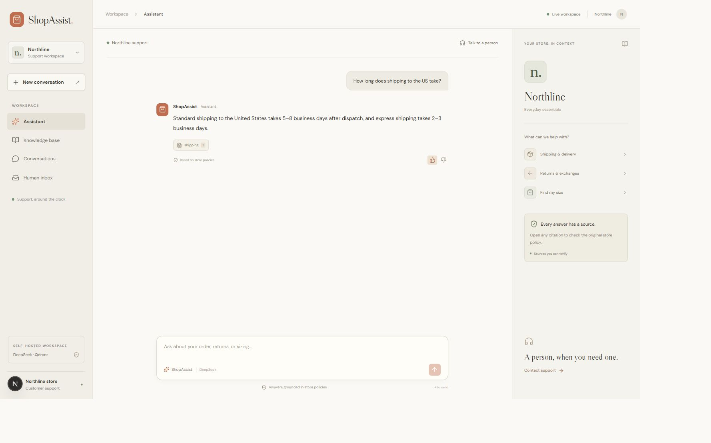
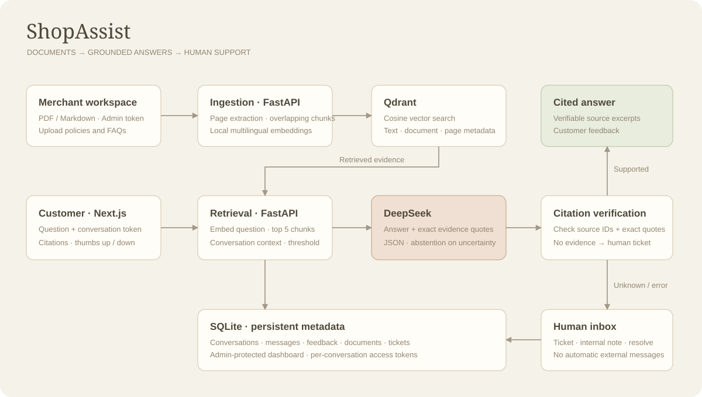
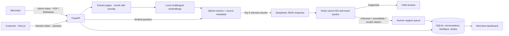

# ShopAssist

AI customer support for independent stores. Next.js, FastAPI, DeepSeek, and Qdrant. MIT licensed.

[Open the interactive sandbox](https://likeyeee.github.io/shopassist-ai-support-bot/) · [Watch the one-minute walkthrough](docs/demo.mp4)



## Run locally

Requires Node.js 24 and Python 3.11. Run commands from the repository root.

```bash
npm ci
python -m venv .venv
# macOS / Linux
source .venv/bin/activate
# Windows PowerShell: .venv\Scripts\Activate.ps1
pip install -r backend/requirements.txt
python scripts/setup.py
```

Set `DEEPSEEK_API_KEY` in the generated `.env`. A random `ADMIN_TOKEN` is generated for you. Never commit either value.

```bash
# Terminal 1
uvicorn backend.main:app --host 127.0.0.1 --port 8000
# Terminal 2
npm run dev
# Optional sample policies (the first upload downloads the embedding model)
python scripts/seed.py
```

Open **http://127.0.0.1:3000**. Use the `ADMIN_TOKEN` from `.env` to open the knowledge base, conversation history, and human inbox. API documentation is at **http://127.0.0.1:8000/docs**.

Local mode uses **persistent Qdrant embedded storage** and SQLite under `data/`. No database account is required. Embeddings run locally with `sentence-transformers/paraphrase-multilingual-MiniLM-L12-v2` through FastEmbed; DeepSeek generates answers. Changing the embedding model requires reimporting documents into a fresh data directory.

## Try the flow

1. Open **Knowledge base** and upload a text PDF or UTF-8 Markdown document, or load the included sample policies.
2. Ask “How long does shipping to the US take?” or “你们的退货期限是多少天？”
3. Open the source chip to inspect the exact supporting quote. Leave a thumbs-up or thumbs-down.
4. Ask for a human, request an order-specific action, or ask a question outside the policies.
5. Open **Human inbox**, inspect the full conversation, add an internal note, and resolve the ticket.

## Architecture





## Browser sandbox

```bash
npm run demo
# Or generate a static sandbox:
npm run build:demo
python -m http.server 3000 --directory out
```

The sandbox is explicitly labeled in the UI. It uses **local keyword matching and source excerpts**, not an LLM or Qdrant. Documents, conversations, feedback, and tickets persist in that browser's local storage. Markdown and text PDFs can be imported. No API key or admin secret is included in the browser bundle. PDF sandbox citations display document excerpts rather than page-accurate provenance. Use the full backend for real RAG and page-level citations.

## Docker

```bash
python scripts/setup.py
# Add your DeepSeek key to .env
docker compose up --build -d
docker compose exec shopassist python scripts/seed.py
```

Open **http://127.0.0.1:8000**. The Docker image builds the Next.js static frontend and serves it from FastAPI on the same origin. Compose adds a private Qdrant service and persistent volumes; Qdrant has no exposed host port. The app runs as a non-root user. The local process uses Qdrant embedded storage; Compose uses the Qdrant service.

For an internet deployment, place this service behind HTTPS, set `ALLOWED_ORIGINS` to your frontend origin, and use a strong unique admin token. Keep one API worker for this MVP: request limits and locks are process-local, and SQLite is the metadata store. No hosting account or paid infrastructure is provisioned by these files.

## Configuration

| Variable | Purpose |
| --- | --- |
| `DEEPSEEK_API_KEY` | Server-side provider credential. Missing or failed calls create a human ticket. |
| `DEEPSEEK_MODEL` | Model ID; defaults to the supported `deepseek-chat` alias. |
| `DEEPSEEK_BASE_URL` | Defaults to `https://api.deepseek.com`. |
| `ADMIN_TOKEN` | At least 24 characters; required at startup. |
| `DATA_DIR` | SQLite, embedded Qdrant, and downloaded model cache. |
| `EMBEDDING_MODEL` | FastEmbed model; defaults to multilingual MiniLM. |
| `RETRIEVAL_THRESHOLD` | Minimum cosine similarity; default `0.35`, tune for your corpus. |
| `QDRANT_URL`, `QDRANT_API_KEY` | Optional external Qdrant service. Blank URL selects embedded mode. |
| `ALLOWED_ORIGINS` | Comma-separated browser origins; no wildcard default. |
| `NEXT_PUBLIC_API_URL` | Frontend API URL, frozen at build time. Docker uses `/api`. |
| `NEXT_PUBLIC_DEMO_MODE` | Build-time flag for the browser-only sandbox. |
| `NEXT_PUBLIC_BASE_PATH` | Optional static hosting subpath; GitHub Pages uses the repository name. |

## Checks

```bash
pip install -r backend/requirements-dev.txt
python -m pytest backend/tests -q
npm run typecheck
npm run build
npm audit --omit=dev --audit-level=high
```

Tests exercise real Qdrant persistence with a deterministic test embedder; model downloads and paid LLM calls are excluded from automated tests. Coverage includes PDF parsing and page provenance, import deduplication, source deletion, session isolation, admin authorization, feedback, ticket lifecycle, unknown-answer handoff, malformed citations, provider failures, upload limits, and rate limits.

Manual integration verified real multilingual embeddings plus the configured DeepSeek API: English shipping and returns questions, Chinese returns, and an order-specific refund handoff. See [verification notes](docs/verification.md).

## Scope

- Single-store MVP. Admin access uses a shared bearer token stored in session storage; customer conversations use separate opaque capability tokens stored locally and hashed in SQLite.
- The model must supply supporting quotes. The server checks that quotes exist in the retrieved sources; this verifies provenance, **not** a mathematical guarantee that every generated claim is entailed.
- Low retrieval confidence, invalid citations, missing provider configuration, and provider errors fall back to an internal human ticket. An explicit human request skips the LLM. Open tickets keep subsequent messages in the support queue.
- Tickets are an **internal queue**, not a live-agent chat or email integration. Resolving a ticket or adding an internal note does not send a customer notification.
- No store/order-system connection, refund execution, OCR, background import jobs, billing, multi-tenant roles, or production SLA. Text PDFs: up to 100 pages, 5 MB, and 150,000 extracted characters. Initial model download needs internet access.
- Sample Northline policies are fictional demo content. Replace them before using the app for a real store.

Provider and vector interfaces follow the [DeepSeek chat API](https://api-docs.deepseek.com/api/create-chat-completion/) and [FastEmbed supported models](https://qdrant.github.io/fastembed/examples/Supported_Models/).
